# CART253 Projects

## Sawyer Power

>

## First Project Prototype:

[View this project online](./topics/Prototype-project/index.html)

This project allows you to witnesss a very brightly coloured space.

You control a purple coloured ball with your mouse.

Thats about it!

> 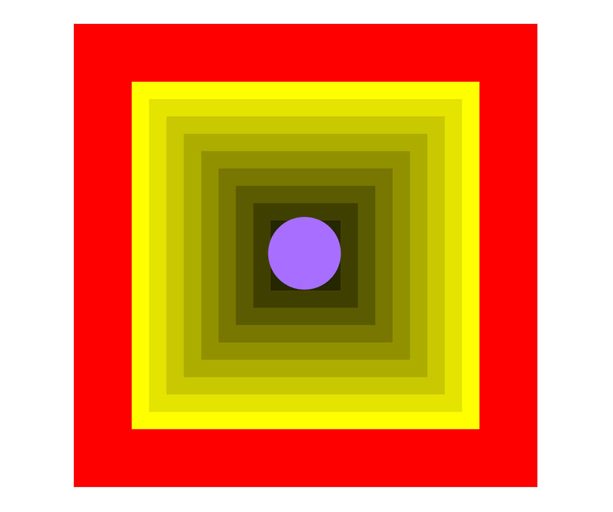

## PROTOTYPING: INSTRUCTIONS!!!

### Prototype 1: 

[Link to Rainbow Prototype](./Rainbow-Prototype1/index.html)

This prototype is a beautiful rainbow!

> 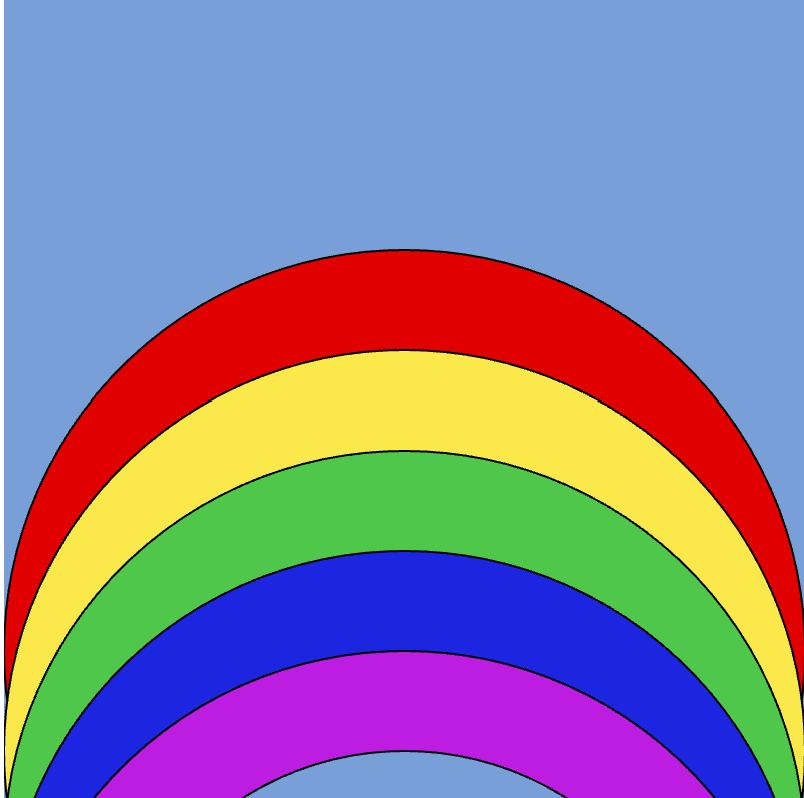

[Link to Code](https://github.com/Barcode1100/cart253/blob/main/Rainbow-Prototype1/js/script.js)

### Prototype 2:

[Link to House Prototype](./House-Project/index.html)

This prototype is a house with absolutely NOTHING wrong with it.

> 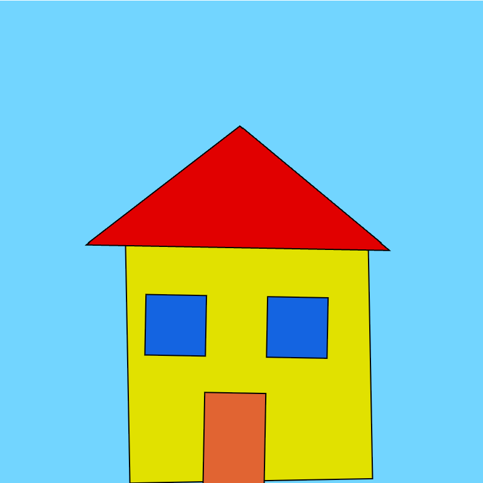

[Link to Code](https://github.com/Barcode1100/cart253/blob/main/House-Project/js/script.js)

### Prototype 3:

[Link To Terrifying Entity Prototype](./Terrifying-Entity/index.html)

This prototype is the scariest thing you will EVER see.

> 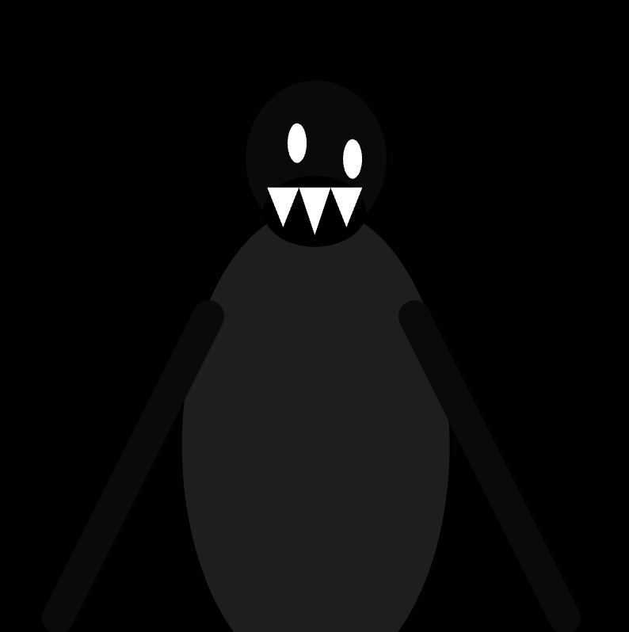

[Link to Code](https://github.com/Barcode1100/cart253/blob/main/Terrifying-Entity/js/script.js)

## VARIABLES CHALLENGE:

Completed alongside Nick!

[Link To Mr Furious Challenge](./MrFurious/index.html)

> 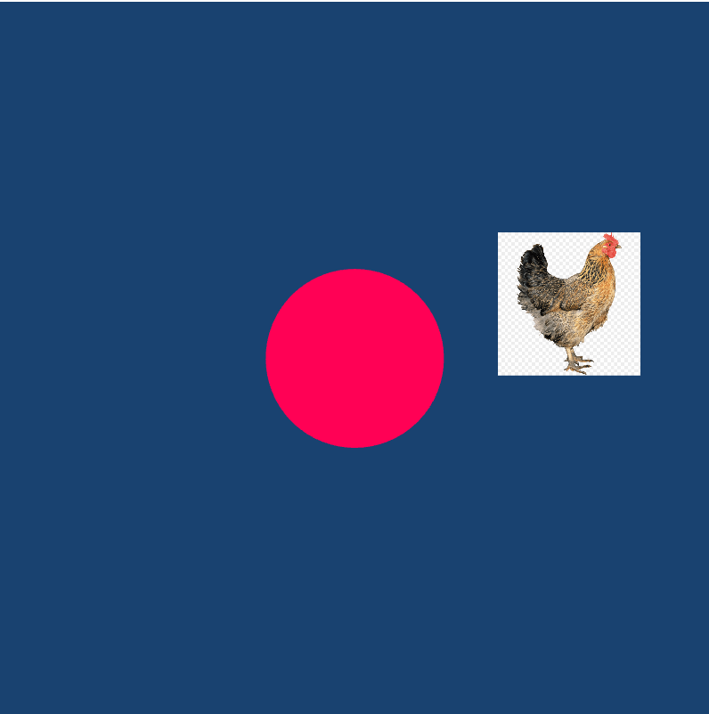

## VARIABLE PROTOTYPES:

### Prototype 1

 [Link to Tree](./A_Tree_Grows/template-p5-project/index.html)

 If you want to watch a digital tree grow? Knock yourself out!

 >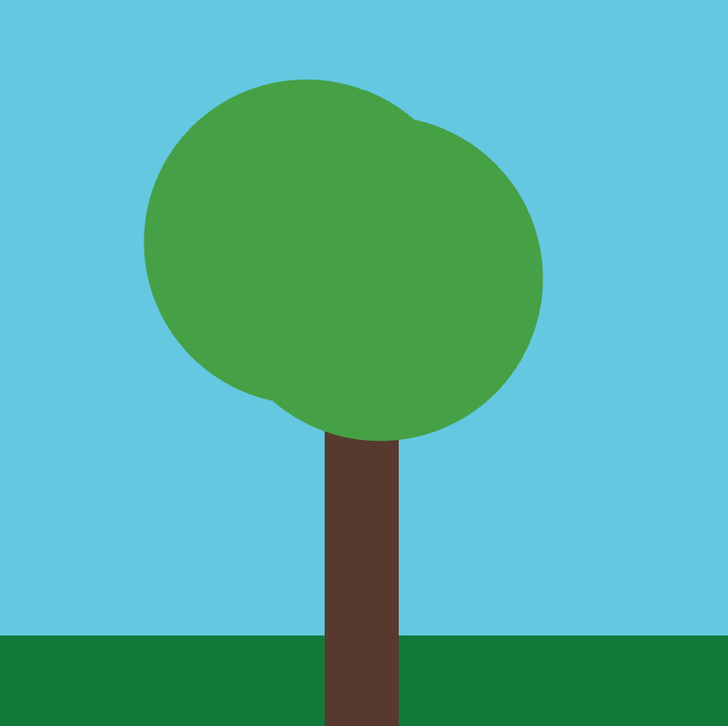

 [Link to Code](https://github.com/Barcode1100/cart253/blob/main/A_Tree_Grows/template-p5-project/js/script.js)

### Prototype 2

 [Link to Creepyeye](./creepyeye_prototype/index.html)

 You can't escape the eye...

 >
 [Link to Code](https://github.com/Barcode1100/cart253/blob/main/creepyeye_prototype/js/script.js)

### Prototype 3

 [Link to Moon Crash](./moon_crashes/index.html)

 Based off of Majora's Mask, the moon crashes down!

 >

 [Link to Code](https://github.com/Barcode1100/cart253/blob/main/moon_crashes/js/script.js)

 ## Conditionals Challenge

 Completed alongside Nick!!

 [Link to Program!](./conditionals/index.html)

 >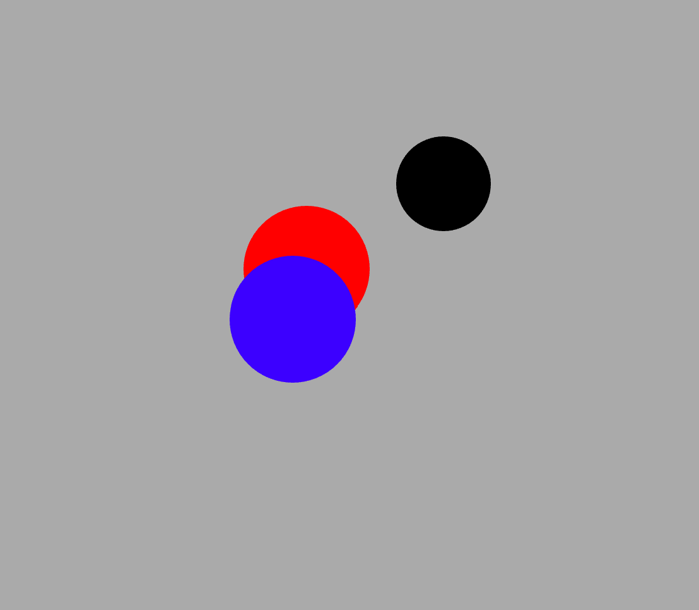

 [Link to Code](https://github.com/Barcode1100/cart253/blob/main/conditionals/js/script.js)

 ## Conditionals Prototypes

 ### Prototype 1

[Link to "To Explode or to Not Explode](./ExplodeWorld-Project/index.html)

Which button will you press?

>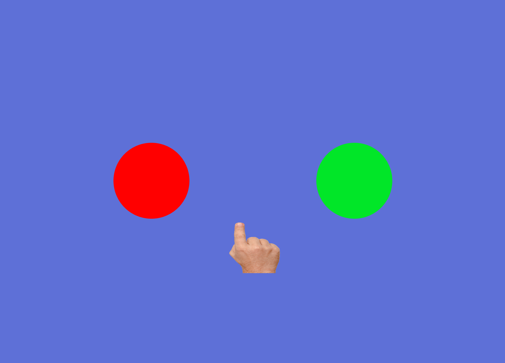

[Link to Code](https://github.com/Barcode1100/cart253/blob/main/ExplodeWorld-Project/js/script.js)

### Prototype 2

[Link to Ghost Finder](./ghostfinder_prototype/index.html)

Can you find the ghost? Do you want to find the ghost?

>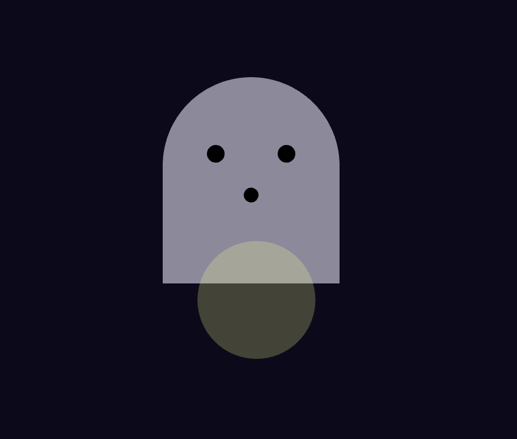

[Link to Code](https://github.com/Barcode1100/cart253/blob/main/ghostfinder_prototype/js/script.js)

### Prototype 3

[Link to Pikachu](./petPikachu_project/index.html)

CLick on Pikachu to pet him! Hold click and move your mouse around and he will stay happy.

>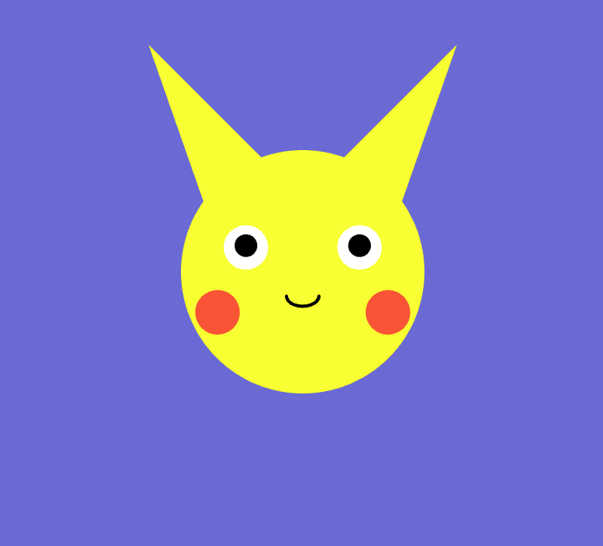

[Link to Code](https://github.com/Barcode1100/cart253/blob/main/petPikachu_project/js/script.js)

## Events Challenge

[Link to Events Challenge](./events/index.html)

Lose challenge if you press anything!

>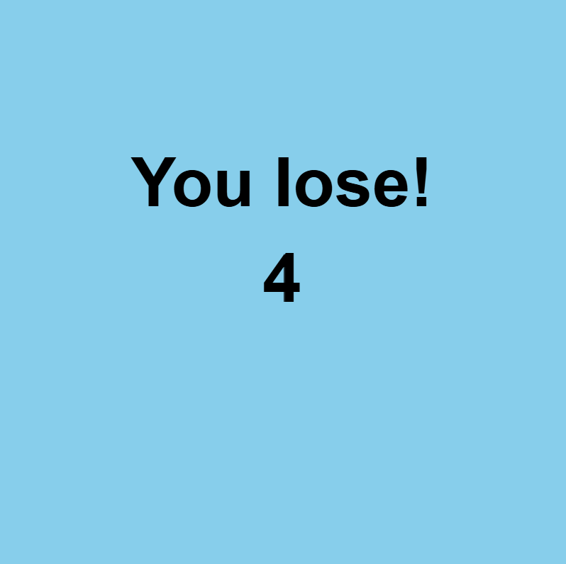

[Link to Code](https://github.com/Barcode1100/cart253/blob/main/events/js/script.js)

## Events Prototype

### Prototype 1

[Link to Morshu Demake](./Morshu%20Prototype/index.html)

Experience the iconic shop from one of the Philips CD-i Legend of Zelda games...but worse!

>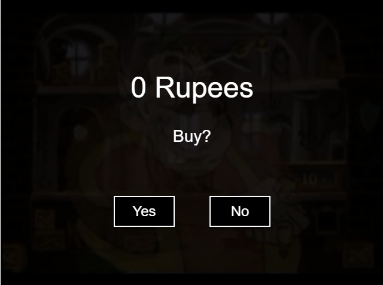

[Link to Code](https://github.com/Barcode1100/cart253/blob/main/Morshu%20Prototype/js/script.js)

### Prototype 2

[Link to Drumset](./drumset_prototype/index.html)

Become the ultimate drummer as you type away on your keyboard.

>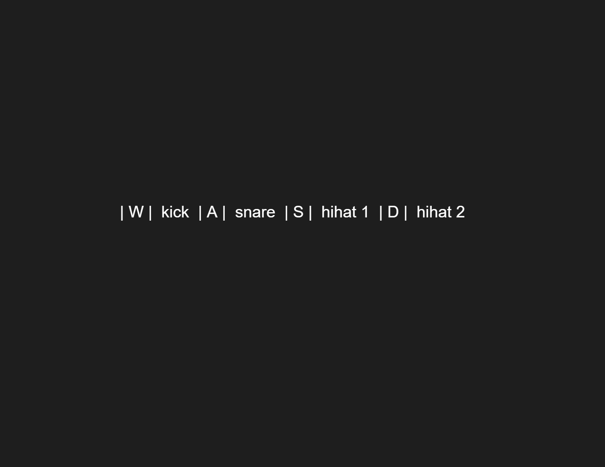

[Link to Code](https://github.com/Barcode1100/cart253/blob/main/drumset_prototype/js/script.js)

### Prototype 3

[Link to Freddy Clicker](./freddy_prototype/index.html)

Click Freddy as fast as possible to not die!

>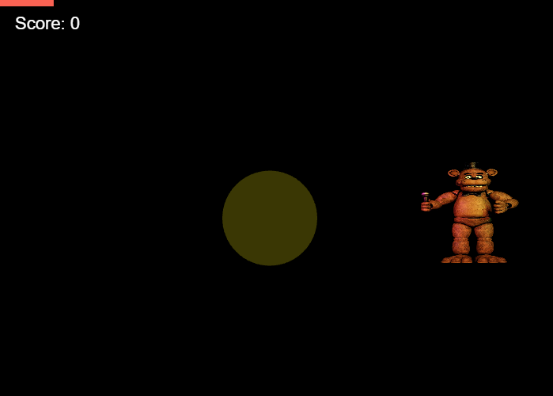

[Link to Code](https://github.com/Barcode1100/cart253/blob/main/freddy_prototype/js/script.js)

## Function Prototypes

### Prototype 1

[Link to Cute Shark](./cuteshark_prototype/index.html)

These cute sharks are relatively harmless but if you want them to get away...just click!

>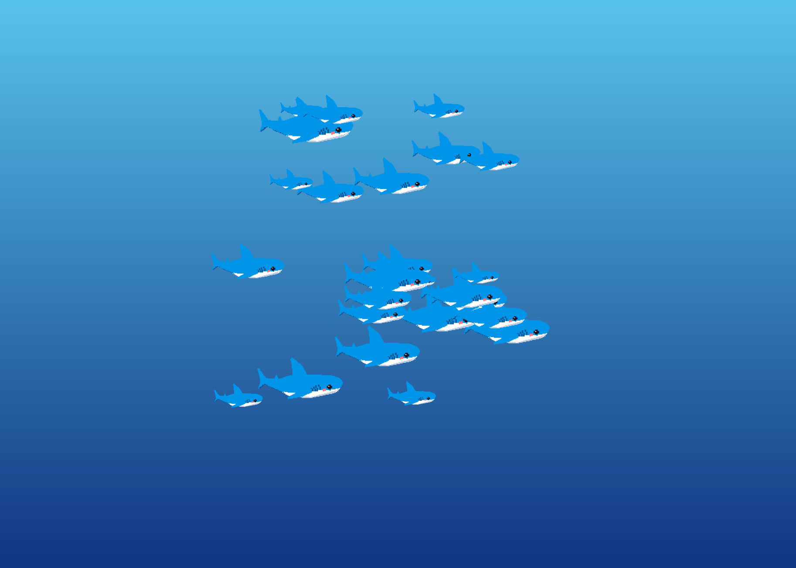

[Link to Code](https://github.com/Barcode1100/cart253/blob/main/cuteshark_prototype/js/script.js)

### Prototype 2

[Link to Sonic Demake](./sonic_demake/index.html)

A Demake of the iconic 'Green Hill Zne' Level from the first Sonic game.

>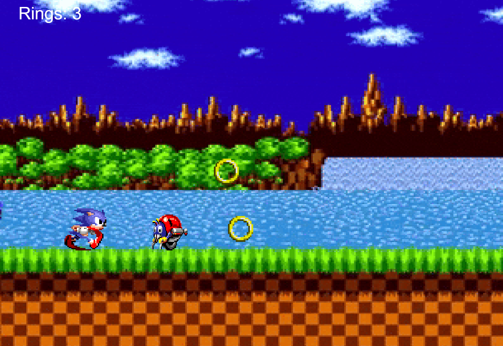

[Link to Code](https://github.com/Barcode1100/cart253/blob/main/sonic_demake/js/script.js)

### Prototype 3

[Link to Fnaf Door Sim](./fnafdoor_prototype/index.html)

Click on any of the 5 doors...whats lurking inside remains a mystery...

>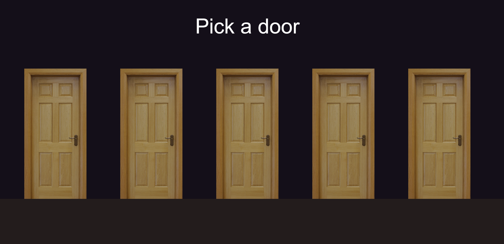

# > [Check out my journal!](./journal.md)

 These projects use [p5.js](https://p5js.org).

 

> This project is licensed under a Creative Commons Attribution ([CC BY 4.0](https://creativecommons.org/licenses/by/4.0/deed.en)) license with the exception of libraries and other components with their own licenses.
